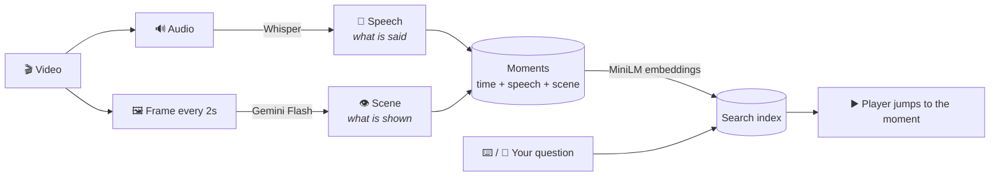
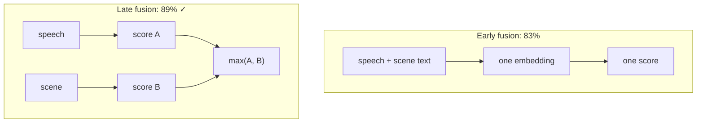

# ASK THE VIDEO

**Search inside a film by describing a moment, or just saying it out loud, and jump straight to it.**

Type *"robots fighting on a tower"* or say *"the part where she says he broke her heart"*, and the player jumps to that moment.

<!-- Replace with your demo recording: -->
<!--  -->

---

## Why I built this

Bitmovin's [Agentic AI Hub](https://bitmovin.com/press-room/) includes **Voice Operated Seeking**: viewers find moments in a video with natural voice commands instead of scrubbing the timeline. I wanted to understand what it takes to build something like that, so I made a small prototype of the idea and **measured** what actually makes it work.

> This is an independent learning project, not affiliated with Bitmovin. It's a prototype of the *idea*, not a copy of their product.

---

## How it works

Every 2 seconds of the film becomes a **moment** with two kinds of text: what is **said** and what is **shown**. A search compares your question with both.



| Step | Tool | Output |
|---|---|---|
| 1. Transcribe the dialogue | [Whisper](https://github.com/openai/whisper) (`base`, runs locally) | What is said, with timestamps |
| 2. Describe what's on screen | Gemini Flash, one frame every 2 s | One-sentence scene description |
| 3. Merge by time | Python | One "moment" per 2 seconds |
| 4. Embed | [`all-MiniLM-L6-v2`](https://huggingface.co/sentence-transformers/all-MiniLM-L6-v2) | A vector capturing each text's meaning |
| 5. Search | Cosine similarity + late fusion | Best-matching timestamps |
| 6. Play | FastAPI + HTML5 video + Web Speech API | The player jumps there |

---

## Results

I built a test set of **18 questions** (dialogue, visual and mixed), phrased the way a viewer would ask without reusing the descriptions' wording, each with the correct time range, and measured **hit@3**: how often a correct moment appears in the top 3 results.

### Speech and scenes are blind to each other

| Search on | Overall | Dialogue questions | Visual questions |
|---|:---:|:---:|:---:|
| Speech only | 56% | **100%** | 0% |
| Scene only | 39% | 0% | **88%** |
| Combined text (early fusion) | 83% | 88% | 88% |
| **Best of both (late fusion)** | **89%** | **100%** | **88%** |

```
Speech only    ███████████░░░░░░░░░  56%
Scene only     ████████░░░░░░░░░░░░  39%
Early fusion   █████████████████░░░  83%
Late fusion    ██████████████████░░  89%
```

**Takeaway:** dialogue search can't find anything visual, and scene search can't find anything said. Each covers the other's blind spot.

### Early vs. late fusion

My first version glued speech and scene text together before embedding them. That lost some dialogue matches, because long scene descriptions "drown out" a short line of speech. Scoring the two separately and keeping the better score fixed it.



---

## Things I ran into

**🌀 The vision model hallucinated famous films.** Asked to describe a *"movie frame"*, Gemini labelled scenes as *Interstellar*, *First Man* and *The Fault in Our Stars*. The model was predicting the kind of caption that usually goes with cinematic images, not recognising this film. Fix: a stricter prompt that only allows describing what's visible. Some guesses still slip through (e.g. *"likely Batman"*), so a regex filter isn't enough on its own.

**👂 Whisper mishears.** For example *"Who'd Adlib?"* and *"Emory overrated"* (probably *"memory overwrite"*). Silent stretches are invisible to speech search, which is why the visual side is needed.

**🚫 Semantic search always returns *something*.** Even *"pizza"* has a nearest match. I added a similarity threshold so nonsense returns "nothing found", which is a trade-off between rejecting nonsense and keeping weak real matches.

**⏳ Free-tier API limits.** Gemini returned `503` (overloaded) and `429` (quota exhausted). The description script uses **exponential backoff** and **saves after every frame**, so it can resume where it stopped.

---

## Limitations

- **Small test set.** 18 questions (only 2 "mixed"), so the percentages are indicative, not precise.
- **One short film.** About 12 minutes; a real library is thousands of hours.
- **Fixed 2-second slots.** Moments don't follow natural scene boundaries.
- **The end credits are partly missing.** Some frames hit the free-tier quota.

## What I'd try next

- **Live streams:** describe frames as they arrive, e.g. for instant sports highlights.
- **Scene-boundary detection** instead of fixed 2-second slots.
- **Ad-break suggestions:** use scene changes and mood to find natural break points.
- **A bigger test set** to tune the threshold and fusion properly.
- **Multi-language search**, since both Whisper and the embeddings support other languages.

---

## Run it yourself

<details>
<summary><b>Setup and pipeline</b> (click to expand)</summary>

**Requirements:** Python 3.10+, `ffmpeg`, a free [Gemini API key](https://aistudio.google.com/apikey).

```bash
git clone https://github.com/khushi-init/ask-the-video.git
cd ask-the-video
python3 -m venv venv && source venv/bin/activate
pip install openai-whisper google-genai python-dotenv sentence-transformers fastapi uvicorn
echo "GEMINI_API_KEY=your-key" > .env
```

Download *Tears of Steel* (720p) from [mango.blender.org](https://mango.blender.org) and convert it:

```bash
ffmpeg -i tears_of_steel_720p.mov -c copy data/tears_of_steel.mp4
```

Build the index:

```bash
python scripts/transcribe.py                 # 1. speech  → data/transcript.json
mkdir -p data/frames
ffmpeg -i data/tears_of_steel.mp4 -vf "fps=0.5,scale=512:-1" data/frames/frame_%04d.jpg
python scripts/describe_frames.py            # 2. scenes  → data/scenes.json
python scripts/build_index.py                # 3. moments + embeddings
python scripts/evaluate.py                   # 4. (optional) results table
```

Start the app and open http://localhost:8000 in Chrome:

```bash
uvicorn app:app --reload
```

</details>

### Project structure

```
ask-the-video/
├── app.py                   # FastAPI server: search endpoint + serves the page
├── web/index.html           # Pixel-style UI, video player, voice search
├── scripts/
│   ├── transcribe.py        # Whisper → transcript
│   ├── describe_frames.py   # Gemini → scene descriptions (backoff + resume)
│   ├── build_index.py       # merge by time + embed (speech / scene / combined)
│   ├── search.py            # search from the terminal
│   └── evaluate.py          # hit@3 per method and question type
├── eval/
│   ├── queries.json         # 18 test questions with correct time ranges
│   └── timeline.txt         # the whole film as text, every 2 seconds
└── data/                    # video, frames, JSON, embeddings (gitignored)
```

---

## Credits

Film: **Tears of Steel** © Blender Foundation | [mango.blender.org](https://mango.blender.org), licensed [CC BY 3.0](https://creativecommons.org/licenses/by/3.0/).